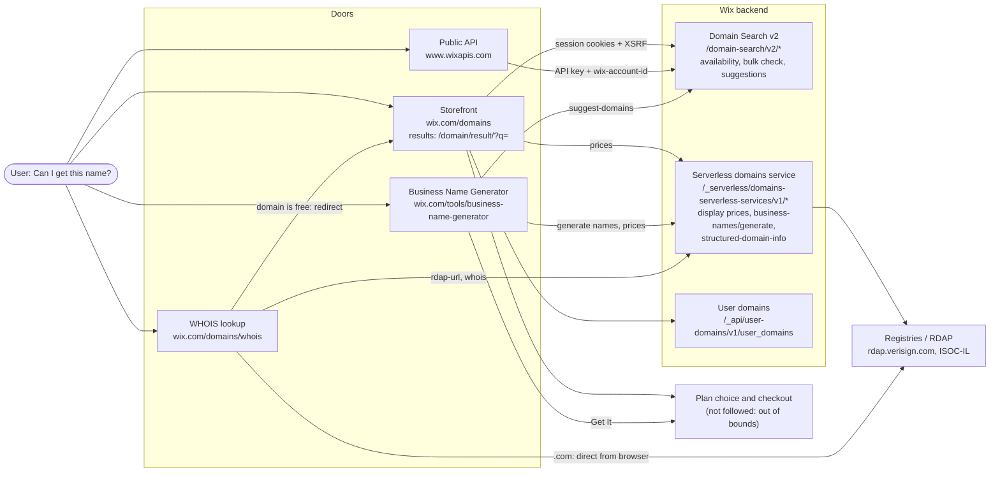

# Architecture: "Can I get this name?"

**How this was mapped:** Chrome DevTools, Network panel (Fetch/XHR, Preserve log), 2026-11-03,
logged in to my own Wix account, browsing from Israel (prices in ₪). This is a black-box map
built from network traffic. Service names come from URL paths, not from Wix code. Saved
responses are in [`evidence/`](evidence/). Items marked ⚠ are not confirmed yet.

## Diagram

## The main relationship

The storefront and the public API call **the same Domain Search v2 paths**
(`check-domain-availability`, `bulk/domain-availabilities/check`, `suggest-domains`). Only the
host and auth differ:

| | Host | Auth |
|---|---|---|
| Storefront | `www.wix.com` | session cookies + XSRF token |
| Public API | `www.wixapis.com` | account-level API key + `wix-account-id` header |

So availability most likely comes from one backend, and the API and the storefront can be
compared directly. **Price is not part of that backend.** The public API returns no price. Prices
come from a separate serverless service (`domains-serverless-services`) that only the web doors
call. The BNG name generator and the WHOIS door use the same serverless service.

## Door by door

### 1. Storefront (`/domains` → `/domain/result/?q=lia.com`)

| Call | What it drives on screen | Evidence |
|---|---|---|
| `GET /domain-search/v2/check-domain-availability?domain=` | Exact-match card: available / taken, premium badge | |
| `GET /domain-search/v2/suggested-tlds` | Not shown directly. Returns 63 TLDs in a fixed order (`com, net, co.il, org, …, photo, shop`). The same 63 TLDs, same order, as the TLD price list | [suggested TLDs](evidence/storefront-suggested-tlds.json) |
| `POST /domain-search/v2/bulk/domain-availabilities/check` | ⚠ On-screen effect not confirmed. Checks the searched name on the suggested TLDs: the list minus `com` (the exact match), cut to the first 60. 60 is the bulk API's max, so `.photo` and `.shop` are never checked | [bulk check](evidence/storefront-lia-com-bulk-check.json) |
| `GET /domain-search/v2/suggest-domains?query=lia.com&paging.limit=50` | Suggestion cards ("Great Alternative", "Recommended") and the list below them: 50 items, `hasNext: true`, base64 JSON cursor. The UI has no "load more", so users see page 1 only. Suggestions change between runs (expected) | [suggestions](evidence/storefront-lia-com-suggestions.json), [screenshot](evidence/storefront-lia-com-results-top.png) |
| `GET /_serverless/domains-serverless-services/v1/suggested-tld-display-prices` | Price per TLD for normal results: `price`, `originalPrice`, `pricingStrategy` (FREE_FIRST_YEAR / RENEWAL / MULTI_YEAR_MINIMUM_COUNT), `renewalPrice`. 63 TLDs. `.com` ₪21.47 → renews ₪90.19 | [TLD prices](evidence/storefront-suggested-tld-display-prices.json) |
| `GET /_serverless/domains-serverless-services/v1/display-prices` | Price of one premium domain: `lia.store` ₪5,094.39, REGULAR, renewal the same. Seen once; later it no longer showed in the Network panel even with Preserve log | [display prices](evidence/storefront-lia-store-display-prices.json) |
| `GET /_api/user-domains/v1/user_domains/<domain>` | Ownership check. `lia.com` → 403 `DOMAINS_PERMISSION_DENIED` / `domainBelongsToDifferentUser` (but lia.com is registered at Porkbun, not Wix). `lia.services` → 404 `domainDoesNotExist`. Blocking this request in DevTools changed nothing on the `lia.com` results page. It likely only matters for a domain the user owns; my new account owns none, so I couldn't observe it | |

**How suggestions are built** (from the decoded cursor): each suggestion has an `engine`
(`WixOtherGtld`, `WixPremium`, `VendorDeterministic`). The cursor keeps a `pending` queue for the
next page. In the saved run (an earlier search; suggestions change each time), the bulk check says 7 of 60 same-name domains are available. The 5
non-premium ones (`lia.services`, `.church`, `.photography`, `.events`, `.coach`) are on page 1.
The 2 premium ones (`lia.store`, `lia.biz`) are first in `pending`, so they never appear on screen.
Searching `lia.store` directly shows it: Exact Match, Available, Premium, ₪5,094.39/yr.

### 2. Business Name Generator

- The user describes a business and gets generated names with a domain for each. The same prompt
  gives different names every run (expected: they are generated).

| Call | What it drives on screen |
|---|---|
| `/_serverless/domains-serverless-services/v1/business-names/generate` | The generated business names (e.g. "Liafique") |
| `GET /domain-search/v2/suggest-domains?query=Liafique&paging.limit=50` | Domains for a generated name. The **same suggestions endpoint as the storefront**, with the generated name as the query |
| `GET /_serverless/domains-serverless-services/v1/suggested-tld-display-prices` | Prices and the renewal tooltip. **Same price call as the storefront** |

- BNG makes no bulk check and no separate availability call. ⚠ So "available" in BNG most likely
  rests on the suggestions response alone (inferred).
- Price tooltip on the list: "free for one year with any annual plan. Renews at ₪90.19". This
  matches the storefront's `.com` price, as expected from the shared price call.
- **Get It** → plan-choice page on `manage.wix.com`. It loads the price for the one domain from
  `GET manage.wix.com/_serverless/domains-serverless-services/v1/display-prices` (`price`,
  `originalPrice`, `pricingStrategy`, `renewalPrice`), the same call the storefront uses for premium
  domains ([response](evidence/plan-choice-lianova-co-display-prices.json)). "Buy domain only: `<domain>` for ₪21.47/yr" shows **no renewal
  price**, and the (!) icon next to it shows no tooltip. Not clicked further (path to checkout).

### 3. WHOIS lookup

- The same flow for `.com` and `.co.il`, both on `www.wix.com/_serverless/domains-serverless-services/v1/`:
  `structured-domain-info/rdap-url?domain=` returns which RDAP server to use, then
  `structured-domain-info/whois?domain=&parse=` returns the record.
  `parse=false` for `.com`, `parse=true` for `.co.il`.
- For `.com` the browser also fetches the record directly from `rdap.verisign.com`.
- `.co.il` records are not redacted by the registry (ISOC-IL policy, expected). The copy in
  `evidence/` was redacted by me before committing because it holds a real person's details.
- A domain that is free (`lia.services`) redirects to the storefront results page.
- Evidence: [RDAP lia.com](evidence/whois-rdap-lia-com.json), [WHOIS lia.co.il](evidence/whois-lia-co-il-redacted.json)

### 4. Public Domain Search API

- `GET /domain-search/v2/check-domain-availability?domain=` →
  `{availability: {domain, available, premium, premiumType}}`. Non-premium domains return
  `premiumType: UNKNOWN_PREMIUM_TYPE` (the enum default).
- `POST /domain-search/v2/bulk/domain-availabilities/check`: max 60 domains, more → 400.
- `GET /domain-search/v2/suggest-domains`: TLD filter without the dot (`com`).
- Unsupported TLD → `DOMAINS_UNSUPPORTED_TLD`. No price in any response.

## What this means for testing

- **Availability:** one backend behind the storefront and the API → test it once via the API,
  then check the storefront shows what the backend returned.
- **Price:** only in the web doors → price disclosure (premium, renewal) can only be tested in
  the UI. Storefront and BNG should show the same price for the same TLD.
- **Suggestions:** generated and paginated, and the UI shows page 1 only → what is on page 1
  decides what users can buy. Assert on rules (every suggestion is really available), not on
  exact lists.
- **WHOIS:** depends on outside registries → results and redaction differ by TLD.
- **Checkout** is the boundary: every flow stops before it.

## Not mapped (open questions)
- What the bulk check drives on screen.
- What the ownership call changes for a domain the user owns.
